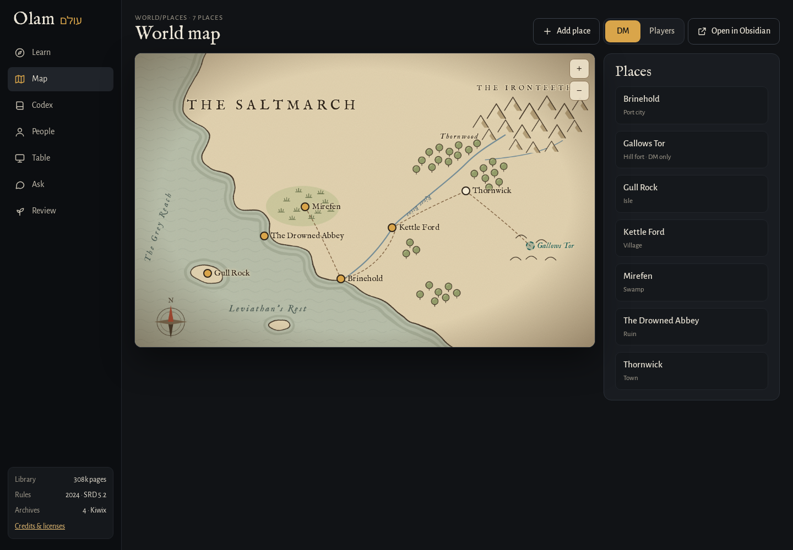
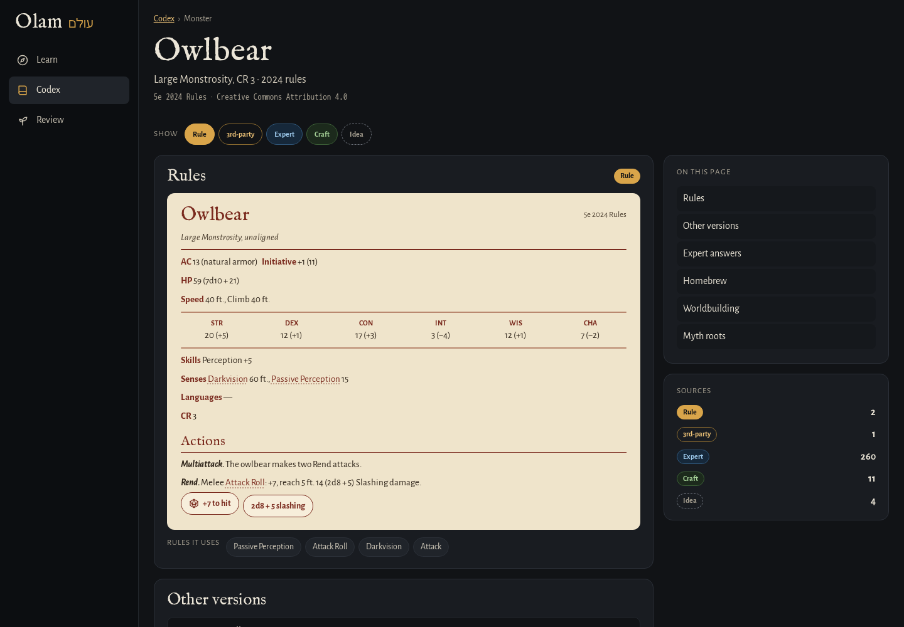
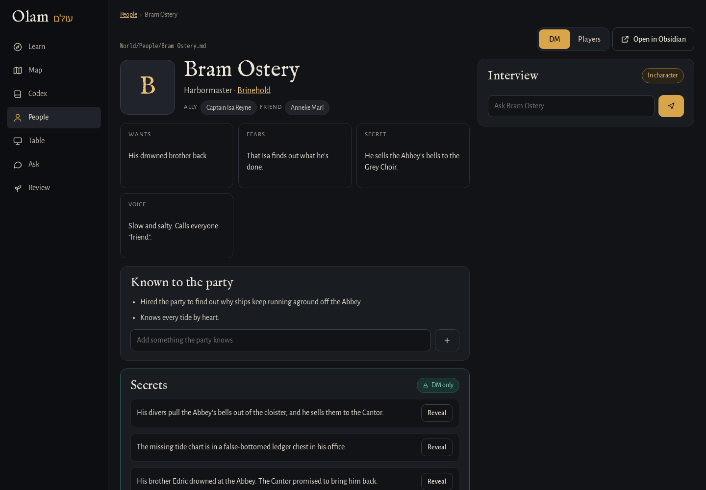

<p align="center">
  
</p>
<h1 align="center">Olam</h1>
<p align="center"><b>A place to learn D&amp;D and build a world to run it in.</b><br>Short lessons on the 2024 rules, a wiki built from every free source I could find, and your Obsidian vault as the world.</p>
<p align="center">
  
  
  
  
  
</p>
<p align="center">
  <a href="https://stuffs.tiresia.xyz/olam/"><b>Try the demo</b></a> ·
  <a href="#install">Install</a> ·
  <a href="#whats-in-it">What's in it</a> ·
  <a href="#the-vault">The vault</a> ·
  <a href="#where-it-all-comes-from">Sources and licenses</a>
</p>



## Why I built it

I wanted to get into D&D, and I wanted to run games one day, not just play. The trouble is that the good information is everywhere: the free rules, years of answers on RPG Stack Exchange, homebrew wikis, worldbuilding advice, and the books on my shelf. None of it talks to the rest, and none of it tells you how far to TRUST it.

So I built one place for all of it. Olam (עולם, Hebrew for "world") teaches the 2024 rules as a road of short lessons, and behind the lessons is a wiki where every page pulls together the official rules, other versions, expert answers, homebrew and even the myths behind a monster, each one marked with where it came from. And since a DM needs a world, Olam reads and writes an Obsidian vault, so the map, the people and the next fight live in notes you own.

Basically, instead of ten tabs and a notebook, I have ONE place to learn the game and build the world I'll run it in.

## What's in it

- **Learn.** The Road is 18 stops over six weeks, from "What a session looks like" to "Find your players." Each lesson has four steps (Read, See, Do, Check), the questions you miss come back in Review, and the Atlas of Rules clears its fog as you master what each stop teaches.
- **Codex.** Search everything at once: rules, monsters, spells, items, classes, the archives, and your own books if you add a Calibre library.
- **Wiki pages.** Every entry has a hub page with the official text, other versions, the rules it uses, expert answers, homebrew, worldbuilding Q&A, myth roots, passages from your books and your own notes, each with a badge for its shelf.
- **Ask.** A rules question is answered from numbered sources, 2024 rules first, and the answer cites them.
- **AI Game Master.** A short solo adventure where you roll in the app and each new rule comes with a one-line note.
- **Map, People and Table.** Your world, from your vault: pins on your map, the people in it with their ties and secrets, and an initiative tracker with a players' screen for the TV.

The AI features (Ask, summaries, the Game Master and interviews with your characters) use Claude, with an API key or the Claude CLI. Everything else works without them.

## Screenshots

| | |
|---|---|
|  |  |
| **Learn.** The Road, a lesson, and the Atlas of Rules. | **A wiki page.** The rules first, then every other shelf. |
|  |  |
| **People.** Ties, secrets to reveal, and an in-character interview. | **Table.** Initiative, HP, conditions and a players' screen. |

## Install

### With Docker

```bash
git clone https://github.com/franz-rosenzweig/olam.git && cd olam
docker compose build
docker compose run --rm olam fetch          # the SRD 5.2.1 and Open5e's data, about 45 MB
docker compose run --rm olam ingest         # build the library, about a minute
docker compose run --rm olam passwd         # your password
docker compose up -d
```

Then open http://localhost:8462. To turn on the AI features, put `ANTHROPIC_API_KEY=...` in a `.env` file next to `compose.yaml` before `up`. To use your vault, uncomment the two vault lines in `compose.yaml`.

The archives (RPG Stack Exchange, Mythology and Worldbuilding Q&A, and D&D Wiki) are about 1.5 GB more. They fill the Expert, Craft and Idea shelves:

```bash
docker compose run --rm olam fetch zims
docker compose restart olam
docker compose --profile kiwix up -d        # optional: read them in full in Kiwix on :8461
```

### Without Docker

You need Python 3.13 or newer and git.

```bash
git clone https://github.com/franz-rosenzweig/olam.git ~/olam && cd ~/olam
python3 -m venv .venv && .venv/bin/pip install -r requirements.txt
.venv/bin/python -m olam.cli fetch
.venv/bin/python -m olam.cli ingest
.venv/bin/python -m olam.cli passwd
.venv/bin/python -m olam.cli serve          # http://127.0.0.1:8462
```

To keep it running, `systemd/olam.service` is a user service for it. Settings go in `data/olam.env`, and `olam.env.example` lists every one of them: the addresses to listen on, your vault, a Calibre library, Kiwix, and the AI.

If you'd rather use your Claude subscription than an API key, install the Claude CLI and sign in to it as the same user that runs Olam. Olam finds it on its own.

## The vault

Point `OLAM_VAULT` at an Obsidian vault (a new one is best) and run `olam vault-setup`. It makes the World folders, a blank parchment map and templates, and never overwrites anything. Olam writes its notes in the formats of six community plugins, so Obsidian shows the same world: **Fantasy Statblocks**, **Initiative Tracker**, **Dice Roller**, **Leaflet**, **Calendarium** and **Relations**.

- **Add to vault** on a monster page makes `World/Bestiary/<name>.md` with a statblock. **Add to encounter** adds it to `World/Encounters/Next encounter.md`, ready for Initiative Tracker.
- **Map** shows `World/Maps/World map.png` with a pin for every note in `World/Places` that has a `location`, the same frontmatter Leaflet reads. Click to add a place, drag a pin to move it, mark it visited or DM only.
- **People** lists `World/People`: role, home, Relations ties, what they want and fear, what the party knows, and secrets you can reveal at the table, which moves them into "Known to the party" with the date.
- **Table** loads an encounter and your party (`World/Party.md`), rolls initiative, tracks HP and conditions, and writes the result back into the encounter note. The players' screen shows monsters only as Unhurt, Bloodied or Down.

Edits change only the lines they need, so your notes stay the way you wrote them.

## The shelves

| Badge | What it is | Where it comes from |
|---|---|---|
| Rule | Official rules | SRD 5.2.1 (2024) and SRD 5.1 (2014), via the PDF and Open5e's data |
| 3rd-party | Published, not official | Open5e: Kobold Press, EN Publishing (A5e), Black Flag and others |
| Expert | Experienced players answering | RPG Stack Exchange and Mythology Q&A |
| Craft | How to build a world | Worldbuilding Q&A |
| Idea | Inspiration, not rules | D&D Wiki homebrew, and the books in your library |
| Yours | Your notes | your Obsidian vault |

## Where it all comes from

Nothing in this repository is rules text. `olam fetch` downloads each source from where it's published, and the Credits page in the app lists every one with its license.

- **SRD 5.2.1** by Wizards of the Coast LLC, from https://www.dndbeyond.com/srd, licensed CC BY 4.0.
- **Open5e's data** (https://github.com/open5e/open5e-api): the SRDs and third-party books under their own open licenses.
- **Kiwix archives** (https://download.kiwix.org/zim/): RPG Stack Exchange, Mythology and Worldbuilding Q&A (CC BY-SA), and D&D Wiki (GFDL). Olam shows each page's author and links to the original.
- **Your Calibre books** never leave your machine. Olam indexes them for search and shows short passages.

The fonts are IM FELL English and Alegreya Sans, under the SIL Open Font License (`web/fonts/OFL.txt`).

## The demo

`OLAM_DEMO=1` runs Olam as a public demo: only the Creative Commons sources, no sign-in, no AI, no books and no vault, and each visitor's progress stays in their own browser. It's limited to 240 API calls a minute per address. Give it its own library:

```bash
OLAM_DEMO=1 OLAM_DB=data/demo.db .venv/bin/python -m olam.cli ingest open5e srd
```

`systemd/olam-demo.service` runs it next to your own copy on port 8463. Olam only uses relative paths, so both work behind a reverse proxy under a path like `/olam/`.

## How it's made

FastAPI and SQLite (with full-text search) on the server, plain JavaScript in `web/` with no build step, and libzim to read the archives directly. Lessons live in `lessons/road.json`: each stop has `read`, `see`, `do` and `check` sections, and the `do` widgets are `sort`, `modifier`, `array`, `dm` and `advantage`.

If something doesn't work for you, or you'd like a lesson or a source added, open an issue and I'll take a look.

## License

GPL-3.0. See `LICENSE`.
