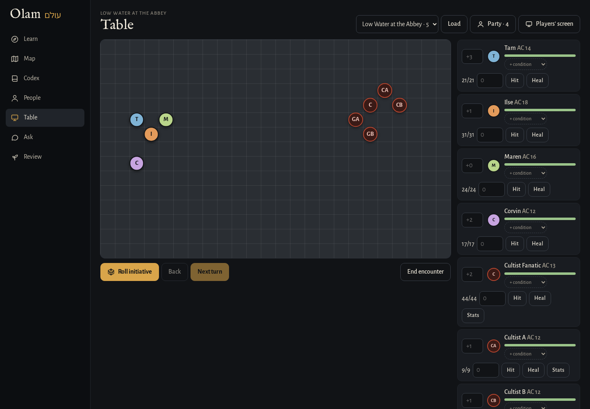

[Olam docs](README.md) › Building your world

# The Table

**Table** is where you run a fight. It loads an encounter and your party from your vault, rolls initiative, keeps track of HP and conditions, puts tokens on a grid, and has a players' screen you can put on the TV. When the fight is over, it writes how it went back into the encounter note.

It needs a vault (see [Your vault](the-vault.md)), and it isn't in the demo.

*Tokens on the grid, and the initiative list with HP and conditions.*

## Before the fight

**The encounter.** Any note in `World/Encounters` with an Initiative Tracker `encounter` block shows up in the list at the top, with how many monsters are in it. The easiest way to make one is **Add to encounter** on a monster's wiki page, which builds `Next encounter.md` for you, but you can also write one by hand in Obsidian with the Encounter template. If a line in the block leaves out a monster's HP, AC or initiative, Olam fills it in from its bestiary note, or from the 2024 rules.

**The party.** Press **Party** to set up the player characters: a name, HP, AC and initiative bonus for each, with **Add** for another one and × to remove one. **Save** writes them into `World/Party.md`, so you only do it once and update it when they level up.

Then pick the encounter and press **Load**. The party goes on the left of the grid and the monsters on the right. When there's more than one of a monster, they get letters, like Goblin A and Goblin B, and their tokens say "GA" and "GB", so you can tell them apart.

## Running it

- **Roll initiative** rolls a d20 for everyone, adds their bonus, and puts them in order. If your players roll their own dice at the table, press it anyway and then type their totals over the ones Olam rolled, in the boxes on the left of the list, and the order updates.
- **Next turn** moves to the next one in line and counts the rounds. It skips monsters that are down. **Back** goes back a turn if you moved on too soon.
- **Hit** and **Heal**: type a number in the box next to someone and press one. The bar shows their HP going from green to amber to red.
- **+ condition** adds one of the 15 conditions, like Prone or Grappled, each with its icon, and clicking a condition removes it.
- **Stats** on a monster shows its statblock right there, with the buttons that roll its attacks and damage. For a homebrew monster from your bestiary, it opens its note in Obsidian.
- **Tokens** can be dragged around the grid, and they snap to the squares. A monster with a picture in the Codex wears it on its token.

Everything you do is saved as you go, so if you close the tab or the browser crashes in the middle of a fight, it's all there when you open Table again.

## The players' screen

**Players' screen** opens the table in a new tab, made for a TV or a second monitor facing the players. It shows the grid with the tokens, whose turn it is and who's next, and the initiative order with the round.

The players see their own HP, but never the monsters' numbers. A monster shows only as **Unhurt**, **Bloodied** (at half its HP or less) or **Down**, which is what the characters would actually be able to see. The screen follows your table every second and a half, so you never touch it during the game.

## After the fight

**End encounter** writes a line under **Results** in the encounter note, with the date, how many rounds it took, who was defeated, and where the party's HP ended up, like:

> - 2026-11-02: 4 rounds. Defeated: Goblin A, Goblin B. The party: Ilse 9/24, Tam 17/17.

Then it clears the table for the next one. Basically, you end up with a short record of every fight in the note where you planned it, which is handy when you write up the session later.

## Next step

That's the whole app. If you're running your own copy, [Your own server](server.md) has the settings and the commands.

Next: [Your own server](server.md) →
