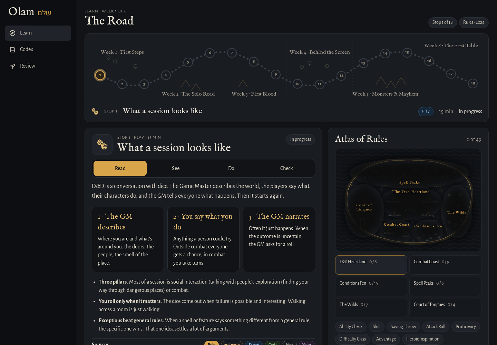

[Olam docs](README.md) › Getting started

# What is Olam?

Olam is a place to learn D&D and build a world to run it in. The name is the Hebrew word for "world" (עולם). It's a web app you open on your computer or phone, and it runs on your own server, so your progress, your notes and your books stay with you.

*The Road, a lesson, and the Atlas of Rules.*

## Why I made it

I wanted to get into D&D, and I wanted to run games one day, not just play. The trouble is that the good information is everywhere: the free rules, years of answers on RPG Stack Exchange, homebrew wikis, worldbuilding advice, and the books on my shelf. None of it talks to the rest, and none of it tells you how far to TRUST it.

So Olam puts all of it in one place and marks every piece with where it came from. It teaches the 2024 rules as a road of short lessons, and since a DM needs a world, it reads and writes an Obsidian vault, so the map, the people and the next fight live in notes you own. Basically, instead of ten tabs and a notebook, you have ONE place to learn the game and build the world you'll run it in.

## The screens

The rail on the left (across the top on a phone) has eight screens. Ask only shows when the AI features are on, and the demo has just Learn, Codex and Review.

| Screen | What it's for |
|---|---|
| **Learn** | The Road: 18 lessons over six weeks, from "What a session looks like" to "Find your players". It's the home screen, because learning is the point. |
| **Map** | Your world map from the vault, with a pin for every place. |
| **Codex** | Search everything at once: rules, monsters, spells, items, classes, the archives and your own books. |
| **People** | The people in your world, with their ties, what they want, and the secrets you haven't revealed yet. |
| **Table** | Run a fight: initiative, HP, conditions, tokens on a grid, and a players' screen for the TV. |
| **Ask** | Ask a rules question and get an answer that cites its sources. |
| **Review** | The lesson questions you got wrong, back again until you get them right. |
| **Settings** | Your password, signing out, light or dark, and what this copy of Olam is connected to. |

Click any monster, spell, condition or rule and you get its **wiki page**, which pulls together everything Olam knows about it: the official text, other versions, expert answers, homebrew, worldbuilding Q&A, myths and your own notes. Rules terms inside any text are links too, and hovering over one shows a short preview.

## How far to trust it

Every source in Olam sits on a shelf, and every shelf has a badge, so you can always tell an official rule from someone's homebrew idea.

| Badge | What it is |
|---|---|
| **Rule** | The official rules: SRD 5.2.1 (the 2024 rules) and SRD 5.1 (2014) |
| **3rd-party** | Published, but not official: Kobold Press, EN Publishing and others, through Open5e |
| **Expert** | Experienced players answering questions: RPG Stack Exchange and Mythology Q&A |
| **Craft** | How to build a world: Worldbuilding Q&A |
| **Idea** | Inspiration, not rules: D&D Wiki homebrew, and the books in your library |
| **Yours** | Your own notes, from your vault |

[Where it all comes from](sources.md) has every source and its license, and so does **Credits & licenses** at the bottom of the rail.

## What works where

Olam runs in two ways, and they're a bit different.

- **Your own copy** has everything: a password, your progress kept on the server, your vault, your Calibre books if you add them, and the AI features if you connect Claude.
- **The public demo** at [stuffs.tiresia.xyz/olam](https://stuffs.tiresia.xyz/olam/) has the lessons, the Codex, the wiki pages and Review, with only the openly licensed sources. There's no sign-in, no AI, no books and no vault, and your progress is kept in your own browser.

The AI features (Ask, Summarize, the Game Master and interviews with your characters) use Claude, either with an API key or with the Claude CLI signed in to a Claude subscription. Everything else works without them. [Ask and the AI](ask-and-the-ai.md) explains what each one does.

On a phone, the web app already fits the screen, and there's a small [Android app](../android/README.md) that shows it full screen.

## Next step

If you want your own copy, go on to [Install](install.md). If you'd rather just try it first, open the demo and start the first lesson, which takes about 15 minutes.

Next: [Install](install.md) →
